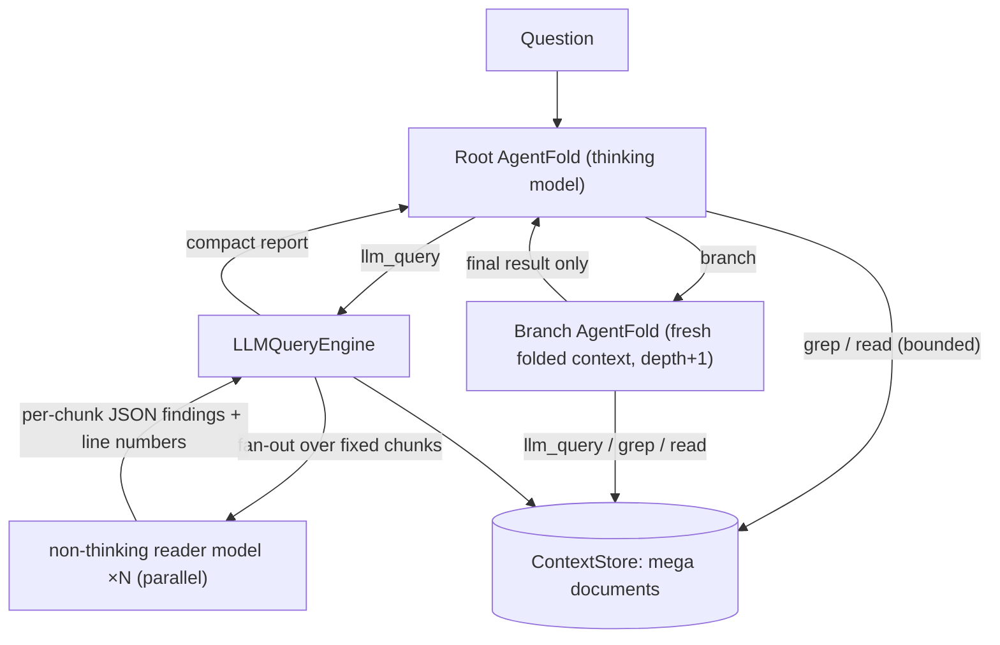

# Recursive AgentFold — Architecture

This document describes the engine in `packages/engine`. It covers what is taken from the AgentFold paper (`docs/AgentFold.pdf`, Ye et al., Tongyi Lab, arXiv:2510.24699) and what is new: `llm_query`, recursive branches, and a cache-preserving prompt layout.

## 1. AgentFold as implemented (paper §3)

**Context** at step *t* (0-based, as in the paper's case studies):

```
C_t = (Q, T, S_{t-2}, I_{t-1})
```

| Part | Meaning | Rendering |
|---|---|---|
| Q | user question (never changes) | `### Task` |
| T | tool schemas (never change) | system prompt `# Tools` |
| S | multi-scale state summaries: a contiguous, gap-free partition of steps `0..t-2` | `**[Compressed Step x]**` / `**[Compressed Steps x-y]**` |
| I | latest interaction at full fidelity: motivation, tool call, tool response | `**[Step n]**` + `**Motivation:**` / `**Tool Call:**` / `**Tool Result:**` |

**Response** (Fig. 7/9 of the paper):

```
<think>…</think>                                       (optional / native reasoning)
<folding>{"range": [k, n], "summary": "…"}</folding>   (omitted at step 0)
<motivation>…</motivation>
<tool_call>{"name": "…", "arguments": {…}}</tool_call>    or    <answer>…</answer>
```

**Folding** (`FoldState.applyFold`) retracts every block inside `[k, n]` (where `n` = the latest step) and the latest interaction, then appends the single block `s_{k,n} = σ`:

- `k == n`: *granular condensation*. A new fine-grained block is appended.
- `k < n`: *deep consolidation*. A chain of blocks plus the latest interaction is merged.

If the model's directive does not follow the rules, it is normalized rather than rejected. The end is forced to `n`. The start is clamped and then snapped to the beginning of the block that contains it. An empty summary is replaced by an automatic one. If the directive is missing, a granular fold with an automatic summary is applied. Each correction is recorded in the `fold` event. Unparseable responses are retried with a repair message appended at the tail of the prompt (`maxFormatRetries`). When the step limit is reached, one final forced-answer turn runs (`forceAnswerOnLimit`).

### 1.1 Externally driven steps

`AgentFoldAgent` also exposes the loop one step at a time:

```ts
agent.begin(question)
const step = await agent.next()   // { kind: 'tool', action } | { kind: 'answer', answer } | { kind: 'done' }
agent.submit(observation)         // feed the tool result back into the fold state
```

`next()` performs the model call, format repair, folding, and parsing, but it does **not** execute the tool. `run()` is the same loop with in-process tool execution, so existing CLI and benchmark behavior is unchanged. A host can use the step API to let its own agent loop execute tools and write native step/tool events.

## 2. What is new



### 2.1 Documents live outside every agent window

`ContextStore` holds the documents, up to millions of tokens. An agent sees only a manifest (id, title, tokens, lines). Content reaches a model in one of two ways:

- `llm_query` chunks, read by the cheap reader model.
- bounded `read` / `grep` windows, which are truncated and line-numbered.

This is RLM's "context as a variable" idea, but driven by tools instead of a REPL.

### 2.2 `llm_query`: the non-thinking reader

When it needs something in a huge context, an agent first calls `llm_query` instead of paging through it with grep, bash, or read:

- **Chunk size** is `contextWindow × (1 − reserveRatio)`. `reserveRatio` defaults to 0.3 and is configurable. A 128K reader therefore gets chunks of about 89.6K tokens, or about 82K with line-number prefixes. The size is clamped so that system + query + output always fit, and it can optionally be capped with `maxChunkTokens`.
- **Modes**:
  - `locate`: does this chunk contain what we are looking for? If so, the reader returns `relevant=true` plus line-numbered evidence.
  - `extract`: map an extraction, classification or count over every chunk. The agent then aggregates the results, using `calculator` for the arithmetic.
- **Parallel**: chunk calls run concurrently (`concurrency`).
- **Report**: a compact report goes back to the agent, listing only relevant chunks and collapsing irrelevant ranges (`#1-3, #5-14`). It is capped at `maxReportTokens`.
- **After locating**: the agent "drills in" with `read`/`grep` on the reported lines, or delegates to a `branch`.
- **Swappable model**: the reader model is independent of the root model. A large root model (e.g. Opus) can run the usual AgentFold scheme while a cheap reader serves `llm_query`.

### 2.3 Recursive branches

`branch` starts a child `AgentFoldAgent` at depth + 1. The child gets its own fresh `FoldState`, the same document store and the same tools, and it can recurse until `maxDepth`. Only the child's final answer returns to the parent, as one tool observation. The parent then folds that observation like any other.

### 2.4 Not losing the cache

RLM's sub-calls are built from ad-hoc string slices, so almost every sub-call is a prefix-cache miss. The engine avoids this in five places:

| Where | Mechanism |
|---|---|
| llm_query chunk calls | Chunks are **deterministic and line-aligned**: the same document and chunk size always give the same `Chunk.key` and byte-identical text. The prompt order is `[system: static] [user: chunk] [user: query]`, so the chunk comes **before** the query. Every later query over the same chunk reuses the cached `system+chunk` prefix. Line-range restrictions select whole fixed chunks instead of re-slicing, so the cache still applies. Agent-requested chunk sizes are quantized to powers of two. |
| llm_query repeats | In-process memo keyed by `(chunk key, mode, query)`, shared by the root and all branches. |
| Root/branch agent | The system prompt (protocol + tool schemas) is identical across steps **and tasks**. The question and manifest come next and are stable for the whole run. Summary blocks are **append-only** under granular condensation. Only the tail (latest interaction + step marker) is new on each step. Format-repair and force-answer messages are appended to the tail, never inserted. |
| Deep consolidation | This is the only operation that invalidates the cache, from `FoldOutcome.firstChangedBlock` onward. The prompt prefers granular folds by default. Consolidations shrink the context, so re-prefilling after one is cheap. |
| Branches | A child's exploration never touches the parent's prefix. |

Cache effectiveness is measured on every call. `UsageTracker` records `cachedTokens / promptTokens` per role (`root`, `branch`, `llm_query`, `direct`). `ScriptedLLM` includes a `PrefixCacheSimulator` for offline layout tests. The unit test `LLMQueryEngine cache behaviour` checks that a second query over the same chunks gets a cache hit rate above 90%.

## 3. Package layout

```
packages/engine/src
  types.ts                 ChatMessage, LLMClient, ModelProfile, usage
  tokens.ts                token estimation, head+tail truncation
  llm/openai-compatible.ts fetch client (Z.ai, OpenAI, vLLM…), retries, thinking switch, cached_tokens
  llm/mock.ts              ScriptedLLM + PrefixCacheSimulator
  llm/usage.ts             UsageTracker (per-role tokens / cache hit rate)
  context/store.ts         ContextStore: documents, deterministic chunking, read, grep, manifest
  fold/state.ts            FoldState: summaries + latest interaction, applyFold semantics
  protocol/parser.ts       tolerant parser for <think>/<folding>/<motivation>/<tool_call>/<answer>
  prompts/agent.ts         AgentFold system prompt (cache-stable)
  prompts/llm-query.ts     reader prompt (chunk-before-query layout)
  tools/llm-query.ts       LLMQueryEngine + llm_query tool + chunk sizing
  tools/document-tools.ts  grep / read / list_documents
  tools/calculator.ts      safe arithmetic
  tools/branch.ts          recursive sub-agent tool
  agent/agent-fold.ts      AgentFoldAgent loop (perceive → reason → fold → act)
  agent/events.ts          trace events
  runtime.ts               RecursiveAgentFold factory (root + branches + llm_query)
```

Plugins can add tools through `RecursiveAgentFoldOptions.extraTools`. Any provider can be used by implementing `LLMClient`.

## 4. Open questions / tuning targets

- `reserveRatio`, `maxChunkTokens`: precision versus cost. Dense aggregation tasks such as OOLONG counting probably need chunks far smaller than 70% of the window.
- A fold policy that weighs cache invalidation against context size, using the measured `firstChangedBlock` and token counts.
- Batched llm_query (several queries per chunk in one call) to amortize the chunk prefill further.
- Anthropic-style explicit `cache_control` support. `ChatMessage.cacheBreakpoint` is already emitted at the right positions.
